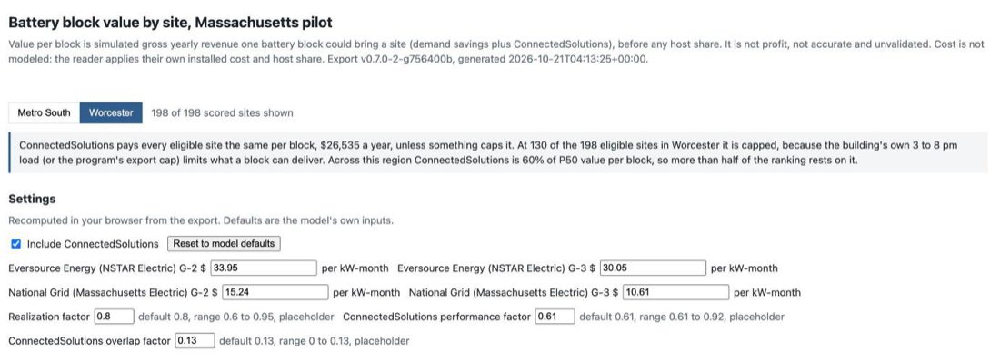
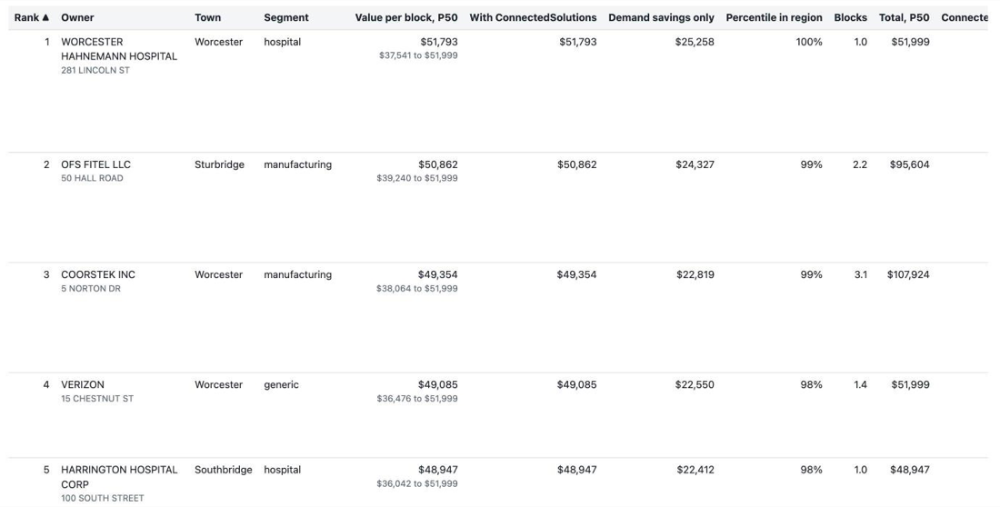
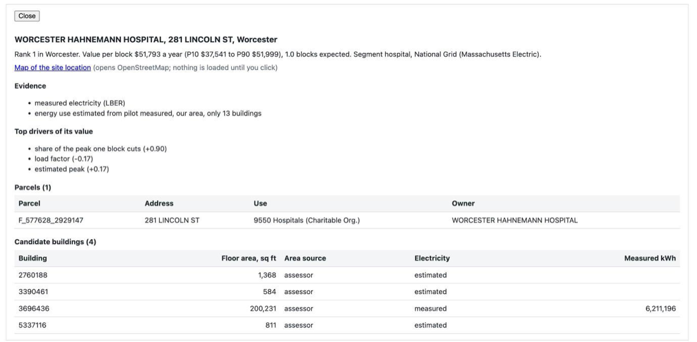

# ma-battery-prospecting

Ranks Massachusetts commercial and industrial sites by value per battery
block: the simulated yearly demand savings plus ConnectedSolutions revenue
that one standard behind-the-meter battery block could bring a site, gross,
before any host share. It uses public data only, covers two pilot regions
(Metro South around Brockton, and Worcester), and comes with a P10 to P90
band and the reasons for each site.

## What this is and is not

- It is a prospecting list: which buildings to talk to first, and why. A
  site's place in the list is a reason to call it, not a forecast of its
  savings.
- Value per block is simulated gross yearly revenue per battery block,
  before any host share. It is not profit and it is not accurate: nothing
  in docs/VALIDATION.md supports an accuracy figure for it, and peak shape
  is unvalidated until real interval meter data tests it.
- Cost and profit are not modeled. Installed cost, the host's share of the
  savings, financing and tax credits are left to the operator.
- It uses public data only: MassGIS parcels, footprints and electric
  providers, DOER's Large Building Energy Reporting (LBER), NREL ComStock
  load profiles and published tariffs. An operator can add one optional
  file of its own, a customer status list, which the report reads in the
  browser and never uploads.
- It is not affiliated with Powertown and does not use Powertown's data.
  The battery block size (250 kW, 522 kWh) is read from Powertown's public
  product page (docs/METHOD.md). Nothing here says anything about
  Powertown's customers, contracts or revenue split.
- Prior work: an earlier public prototype,
  github.com/thutch17/powertown-hackathon, ranked sites by building size
  and town permit history. In the pilot towns that is a size-only ranking,
  and this project uses it as the baseline to beat (docs/VALIDATION.md).

## Start here

The shortest path to the report needs no database and no internet, because
the export it is built from is committed in export/.

1. Install Python 3.11 or later and uv (docs.astral.sh/uv). Node 22 is
   optional: it is only needed for the JavaScript parity test.
2. Clone and build:

       git clone https://github.com/Ifrad/ma-battery-prospecting.git
       cd ma-battery-prospecting
       make report

   `make report` creates a virtual environment with uv on first run and
   writes report.html (about 8 MB) in the repository root.
3. Open report.html by double click, or `open report.html` on macOS. It is
   one self-contained page: data, styles and scripts are inline, and it
   makes no network requests. The only link out is a map link in the site
   detail view, which loads nothing until you click it.

report.html is built, never committed. A built copy is attached to each
GitHub release from v0.7.0.

To run the tests, including the JavaScript parity test when Node is
installed:

    make check

Without a database the tests that need one skip; everything else runs.
Checked from a fresh clone on 2026-10-21 (macOS, uv, Node 22, no database
reachable): `make report` wrote report.html, and `make check` passed with
only the database tests skipped; the Node parity test ran and passed.

## How the value is estimated

Step by step, in the order the pipeline runs. docs/METHOD.md has the
detail; every number below is in config/ with a status, sourced or
placeholder (docs/ASSUMPTIONS.md lists each placeholder and how it would be
tested and replaced).

1. Candidate sites. Buildings on touching commercial, industrial and
   hospital parcels with the same normalized owner, within one town, are
   grouped into one outreach site (config/sites.yaml), with their buildings
   and floor areas. The two pilot regions have 9,640 candidate sites
   (docs/FUNNEL.md).
2. The funnel (docs/FUNNEL.md, thresholds in config/funnel.yaml, all
   placeholders):
   - The site's utility must run ConnectedSolutions. This drops 448 sites
     served by municipal light plants, which are not eligible and are not
     scored.
   - Estimated use above 10,000 kWh a month, National Grid's G-1 line.
   - Estimated peak. Sites at 150 kW or more are scored; the 200 kW line,
     National Grid's G-2 to G-3 boundary, is kept as a flag. That leaves
     354 scored sites, 156 in Metro South and 198 in Worcester, of which
     255 pass 200 kW (docs/SCORES.md).
3. Yearly electricity. Tier 1 sites have at least one building with
   measured grid electricity in LBER; that building uses its reported kWh
   (spread around it when the LBER match is weak). Tier 2 sites are
   estimated only: floor area times their segment's kWh per sq ft, drawn
   from the spread of measured LBER buildings (config/intensity.yaml), with
   the floor area itself drawn within its measured error. Of the scored
   sites, 180 are tier 1 and 174 tier 2.
4. Load profile. Each site is matched to a ComStock building type
   (config/profiles.yaml): hospitals to Hospital, other healthcare to
   Outpatient, warehouses to Warehouse, other sites by assessor use code.
   ComStock has no factories, laundries, food plants, cold storage or auto
   repair; those 91 scored sites are flagged no open profile and take the
   widest simulated range in their size bin. Generic sites with an unmapped
   use code take all types pooled (placeholder mix).
5. Peak. The monthly peak is yearly kWh over 8,760 hours, divided by a
   monthly load factor drawn from the site's simulated type
   (config/simulation.yaml). Peak shape is simulated, one weather year
   (2018), and unvalidated; it was only stress-tested (see Validation).
6. The battery block: 250 kW and 522 kWh (config/battery.yaml, sourced),
   90 percent usable (a placeholder).
7. Dispatch and the monthly demand reduction. On each ComStock building,
   one block was simulated month by month with perfect foresight: the
   lowest monthly peak it can hold without running out (docs/METHOD.md,
   Battery dispatch rule). The model takes the share of the peak one block
   cut in buildings of the same type and size bin, caps the cut at 250 kW,
   and multiplies it by the realization factor, because a real controller
   does not know the month in advance.
8. Expected blocks. One block per 1,000 kW of estimated peak, at least one,
   each taking an equal share of the load (config/model.yaml, a
   placeholder). This is a sizing rule, not an optimum: cost is not
   modeled. Expected blocks is the mean over the draws.
9. Simulated draws. Each site is drawn 1,000 times, seeded by site and
   building id so results never depend on row order. Each draw has its own
   yearly kWh, floor area, load factor, peak and reduction share, so its
   own value per block. P10, P50 and P90 are the 10th, 50th and 90th
   percentiles over the draws; P50 is the headline, and P10 to P90 is the
   band.
10. Ranking. Sites are ranked within each region by P50 value per block
    with ConnectedSolutions; ties are broken by expected blocks, then by
    P50 total (value per block times blocks).

## Rate classes and demand charges

Demand charges are in config/rates.yaml with the tariff and the date each
was read (2026-10-20). Only National Grid and Eversource sites are scored.

| Utility | Class | Who is on it, in the model | Dollars per kW-month | Source |
|---|---|---|---|---|
| National Grid (Massachusetts Electric) | G-2 | over 10,000 kWh a month, estimated peak at or below 150 kW, weighted toward G-3 up to 250 kW | $15.24, billed on the all-hours monthly peak | tariff M.D.P.U. No. 1547 and the delivery rate summary M.D.P.U. No. 1-26-I, effective 2026-10-01, sourced |
| National Grid (Massachusetts Electric) | G-3 | estimated peak at or above 250 kW, weighted from 150 kW | $10.61, billed on the peak in the weekday 8 am to 9 pm window | tariff M.D.P.U. No. 1591 and the same summary, sourced |
| Eversource (NSTAR Electric) | G-2, rate 15, Greater Boston | every draw with a peak over 100 kW | $33.95 | tariff M.D.P.U. No. 15I and the rate summary M.D.P.U. No. 1-26-F, effective 2026-09-01, sourced |
| Eversource (NSTAR Electric) | G-3, rate 13, Greater Boston | not used: it is chosen by service voltage, which public data cannot see | $30.05 | tariff M.D.P.U. No. 13I, sourced, recorded only |

How a site is classified:

- National Grid moves a customer from G-2 to G-3 at 200 kW. The peak here
  is an estimate, so a draw with an estimated peak between 150 and 250 kW
  is weighted linearly between G-2 and G-3 (config/model.yaml,
  rate_band_kw, a placeholder). A draw at or below 10,000 kWh a month is on
  G-1, with no demand charge.
- Eversource: every draw over 100 kW is on G-2, rate 15, since G-3 depends
  on service voltage. The Eversource tariff bills off-peak demand at a
  discount inside a seasonal peak window, which the simulation does not
  model, so Eversource sites use the all-hours reduction share
  (config/profiles.yaml, eversource_peak_reduction, a placeholder), flagged.
- Billed demand is the kW peak. National Grid can bill on 90 percent of the
  kVA peak instead; there is no power factor data, so this is a placeholder
  (rates.yaml, demand_basis) that understates demand where the power factor
  is low.
- The rate area of Eversource's two pilot towns, Canton and Sharon, is
  unconfirmed. Eversource prices by legacy service area and no document read
  lists the towns in each. The model assumes Greater Boston (rates.yaml,
  service_area, a placeholder) and flags those sites rate area unconfirmed.
  If they are South Shore, G-2 would be rate 30, billed per kVA. All of
  Metro South's top 10 are in these two towns (docs/SCORES.md), so this
  matters.

From monthly to yearly: the model counts kW-months, the kW cut each month
times 12, under each class, already reduced by the realization factor. Demand
savings per block per year are G-2 kW-months times the G-2 rate plus G-3
kW-months times the G-3 rate. The export keeps the kW-months for every draw,
so the report can reprice them when you change a rate.

## ConnectedSolutions

ConnectedSolutions daily dispatch pays a battery for its average kW during
summer events (June to September, 30 to 60 events of 2 to 3 hours between 3
and 8 pm). Terms are in config/connected_solutions.yaml.

- Rate: $200 per kW per summer, sourced from National Grid's Daily Dispatch
  page and Mass Save's ConnectedSolutions offering materials (read
  2026-10-20). National Grid and Eversource customers are eligible;
  municipal light plant customers are not.
- Performance factor: 0.61, range 0.61 to 0.92, a placeholder. The block
  delivers about 458 kWh per event, which is 153 kW over a 3-hour event
  (0.61 of 250 kW) or 229 kW over a 2-hour event (0.92). The default
  assumes 3-hour events.
- Overlap factor: 0.13, range 0 to 0.13, a placeholder. An event day that
  is also the building's own monthly peak day cannot serve both. A building
  has at most 4 such days in the 4 event months, out of at least 30 events,
  so at most 4 / 30 of event revenue is at risk; the model takes the upper
  bound.
- Event-window load cap (the default, since the model assumes no site
  exports, site_exports, a placeholder): a block cannot curtail more than
  the building uses. Per block the model counts the lesser of 250 kW times
  the performance factor and the building's mean summer weekday 3 to 8 pm
  load per block, from its ComStock type. Sites with no open profile take
  the pooled ComStock ratio (event_window_no_profile, a placeholder).
- Export cap, used only if site_exports is switched on: the program caps a
  site that exports at 150 percent of its peak (sourced, Mass Save). Per
  block the model then counts the lesser of 250 kW and 1.5 times the site
  peak per block, times the performance factor; for a G-3 draw the peak is
  the 3 to 8 pm peak.
- The counted kW is reduced by the overlap factor and paid at $200. When
  nothing caps it, that is 250 x 0.61 x (1 - 0.13) x $200 = $26,535 per
  block per year.

ConnectedSolutions is 56 percent of P50 value per block summed across the
scored sites (docs/SCORES.md). The report computes the same share from the
export and shows it per region, so more than half of the ranking rests on
one program and on placeholder delivery factors.

## The factors in plain words

Three numbers that are not read from any source move the value most. All
three are placeholders, and all three can be changed in the report.

- Realization factor, 0.8 (range 0.6 to 0.95): the share of the simulated
  peak cut a real battery achieves. The simulation knew each month in
  advance; a real controller that misses one 15-minute peak loses that
  month's saving. Applies to demand savings only.
- Performance factor, 0.61 (range 0.61 to 0.92): how much of its 250 kW a
  block delivers on average across a ConnectedSolutions event, set by how
  long events last.
- Overlap factor, 0.13 (range 0 to 0.13): the share of ConnectedSolutions
  revenue lost because some event days are also the building's own peak
  days.

docs/SCORES.md shows how the median site value moves with each factor at
the ends of its range.

Worked example, one site: Worcester Hahnemann Hospital, 281 Lincoln St,
Worcester. It is an example site, not the top site; it ranks first in
Worcester, but Worcester's top is a tier, not an order. From
export/worcester.geojson and export/manifest.json:

- Tier 1: its main building reports 6,211,196 kWh in LBER. National Grid,
  G-3 in every draw, 1.0 expected blocks.
- Demand savings at P50: 2,380.55 kW-months, already times the realization
  factor 0.8, at $10.61 is $25,258.
- ConnectedSolutions: the lesser of 250 x 0.61 = 152.5 kW and its 3 to 8 pm
  load per block (0.401 x a 1,579 kW median peak), so 152.5 kW, times
  (1 - 0.13) is 132.675 kW, at $200 is $26,535.
- Value per block at P50: $25,258 + $26,535 = $51,793, with a band of
  $37,542 to $51,999.

docs/BRIEF.md walks through it in a table with the source of each figure,
and what to doubt about it.

## How to play with the data

In the report, everything is recomputed in your browser from the export:

- Region: Metro South or Worcester. The note under it says how much of the
  region's value comes from ConnectedSolutions and at how many eligible
  sites the event-window load caps it.
- Table: click a column header to sort, click a row (or press Enter on it)
  for the site detail: evidence, top drivers, parcels, buildings and a map
  link. Both scenarios show side by side: with ConnectedSolutions and
  demand savings only.
- Include ConnectedSolutions: switches which scenario the main value and
  the rank use.
- Demand rates: a G-2 and a G-3 input per utility, in dollars per
  kW-month. The Eversource G-3 input changes nothing, because the model puts
  every Eversource site on G-2.
- Factors: realization, performance and overlap, each showing its default,
  its config range and that it is a placeholder. A value outside 0 to 1 is
  not applied; a value inside 0 to 1 but outside the config range is
  applied and labelled an override.
- Reset to model defaults puts every setting back.
- Moved: how many places each site moved from its rank under the default
  settings. It is blank until you change a setting.
- Filters: segment, utility, minimum value per block, and hide sites in the
  status file (on by default).
- Customer status file: an optional CSV you pick in the browser, with the
  columns owner, address, town (optional) and status (customer, contacted
  or declined). It is read locally and never uploaded. A row matches a
  site by owner name or address, compared in upper case with punctuation
  removed, owner names also without company words such as INC or LLC and
  addresses with street words abbreviated (STREET to ST); a town, if given,
  must match too. Matching sites get a status tag and are hidden by
  default. docs/customer_status.example.csv shows the format with made-up
  rows. Real status files (customer_status*.csv) are gitignored and must
  never be committed.

To change the model itself, edit config/ and rebuild:

| Step | What it does | Needs the database |
|---|---|---|
| `make assumptions` | rewrites docs/ASSUMPTIONS.md from config status and notes | no |
| `make score` | rescores every site, stores a new run, writes docs/SCORES.md | yes, with ingested and built sites |
| `make export` | writes export/ from the latest run; refuses if config/ changed since that run | yes |
| `make report` | writes report.html from export/ | no |

So a fresh clone can build the report, change the report's settings and
run the tests, but it cannot rescore after a config change: that needs
PostGIS with the ingested data. Rebuilding from scratch:

    cp .env.example .env    # optional; the defaults match docker-compose.yml
    make db-up migrate      # PostGIS 16 in Docker
    make ingest             # parcels, footprints, providers, LBER (network)
    make sites match-rates
    make comstock simulate  # about 1 GB download, then the battery simulation
    make intensity funnel db-check
    make score validate export report

data/README.md lists every raw source, where it goes and its licence. None
is a manual download. mass.gov returns HTTP 403 to automated downloads,
which blocked only reading the clean peak regulations
(docs/REVENUE_STREAMS.md); they are not an input. `make enernoc` and `make
sensitivity` feed parts of docs/VALIDATION.md and are optional.

## Validation and limits

From docs/VALIDATION.md, which has the detail. None of it is an accuracy
figure for value per block.

- Yearly electricity, towns held out: on 700 pilot LBER buildings the model
  ranks with Spearman 0.47 against 0.43 for size-only, a modest gain, and
  is no closer for manufacturing.
- Calibration: the 80 percent band on yearly electricity holds the measured
  value 79% of the time.
- Peak shape is unvalidated, only stress-tested: with the simulated peak
  cut share reduced, Metro South keeps 14 of its top 15 and Worcester 8.
- Rank stability: Worcester's ranking is a tier, not an order. No
  Worcester site is in the top 15 in more than half the draws.
- EnerNOC meter data (CC BY-NC 3.0) is used only as a local out-of-sample
  test. It is not committed, not in the report, and no input comes from it.
- Real factories in that data use more of their peak in the 3 to 8 pm
  event window (median 0.57) than the model assumes for sites without a
  profile, so factory ConnectedSolutions revenue is probably understated.
- Hospital sanity check, not accuracy: of 24 scored hospitals none fails
  (load factor inside the ComStock hospitals' range, peak at or above
  average in every draw); 4 tier 1 hospitals sit outside the ComStock kWh
  or peak per sq ft range, following their measured LBER electricity.
- Not modeled: installed cost, host share, space for cabinets, utility
  interconnection capacity and owner willingness.

## Repository map

    prospect/            Python package
      ingest/            source clients and loaders (the only place with network calls)
      sites/             parcels, buildings and sites, matching, segments
      priors/            config loading, intensity, ComStock simulation, funnel
      model/             Monte Carlo draws, demand savings, ConnectedSolutions, scoring
      validate/          baseline, energy check, calibration, stability, stress, meters, hospitals
      export/            per-region GeoJSON and CSV, manifest, Python recompute
      report/            report.html builder, compute.js (mirrors the recompute), app.js
    sql/migrations/      numbered SQL migrations
    config/              YAML inputs, each sourced or placeholder
    export/              committed per-region export files and manifest.json
    tests/               pytest tests, fixtures, and tests/js for the Node parity test
    docs/                METHOD, DATA, FUNNEL, SCORES, VALIDATION, ASSUMPTIONS,
                         REVENUE_STREAMS, MATCH_RATES, BRIEF, img/
    data/                ignored by git except data/README.md

## Make targets

| Target | What it does |
|---|---|
| `make check` | ruff lint and format check, then pytest (the Node parity test runs inside it) |
| `make report` | report.html from export/ |
| `make assumptions` | docs/ASSUMPTIONS.md from config/ |
| `make db-up`, `make db-down`, `make migrate` | start and stop PostGIS, apply migrations |
| `make probe` | check the public sources are reachable |
| `make ingest` | load the public sources (`REGION=metro_south` for one region) |
| `make sites`, `make match-rates`, `make db-check` | build sites, write docs/MATCH_RATES.md, check derived tables |
| `make comstock`, `make simulate`, `make intensity`, `make funnel` | priors and the funnel |
| `make score` | score sites, write docs/SCORES.md |
| `make validate`, `make sensitivity`, `make enernoc` | docs/VALIDATION.md and its optional inputs |
| `make export` | export/ from the latest score run |

## Tests and CI

`make check` runs ruff and pytest. Tests never touch the network; they use
small fixtures under tests/fixtures/. Tests that need Postgres skip without
it, and the JavaScript parity test (tests/js/compute.test.js, run with
`node --test`, no npm packages) skips without Node. CI (GitHub Actions)
runs `make check` with PostGIS 16 and Node 22 and fails instead of skipping
when either is missing. A README test checks that the figures quoted here
still match docs/ and config/.

## Tags and releases

Each phase ends with a tag on main: v0.0.1, v0.1.0 to v0.5.0, then v0.7.0
for export and report (built as one phase, so there is no v0.6.0). The owner
attaches the built report.html to each release from v0.7.0.

## Data sources and licences

| Source | Use | Licence or terms |
|---|---|---|
| MassGIS Level 3 parcels | sites, owners, addresses, floor area | MassGIS public data, no warranty |
| MassGIS building footprints | buildings and roof area | public, attribution Rolta, MassGIS, City of Boston |
| MassGIS electric providers | utility per town | public, Massachusetts DPU and MassGIS |
| DOER LBER, calendar 2024 | measured electricity, intensity priors, validation | EEA public data, as is |
| NREL ComStock, 2025 release 3 | load profiles and the battery simulation | ComStock License, BSD style |
| Utility tariffs and program documents | rates and ConnectedSolutions terms | public documents, cited in config/ |
| EnerNOC open data, 2012 | local out-of-sample test only | CC BY-NC 3.0, never committed |

The code is MIT licensed (LICENSE).

## Cite or contact

Cite the repository, github.com/Ifrad/ma-battery-prospecting, with the
release tag you used. Questions and corrections: open an issue on the
repository.
